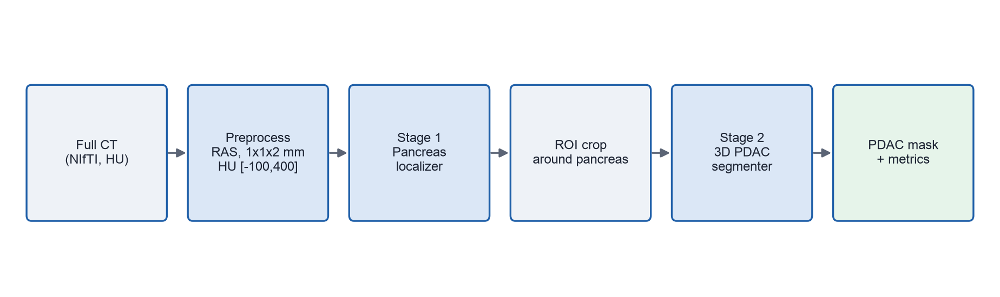
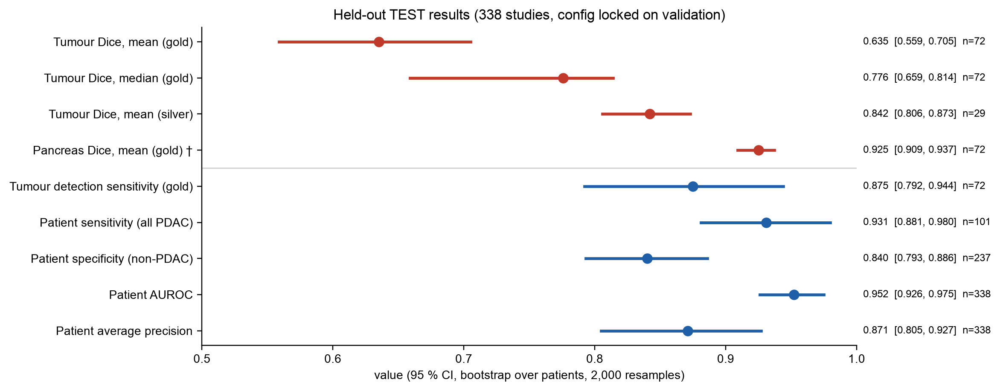
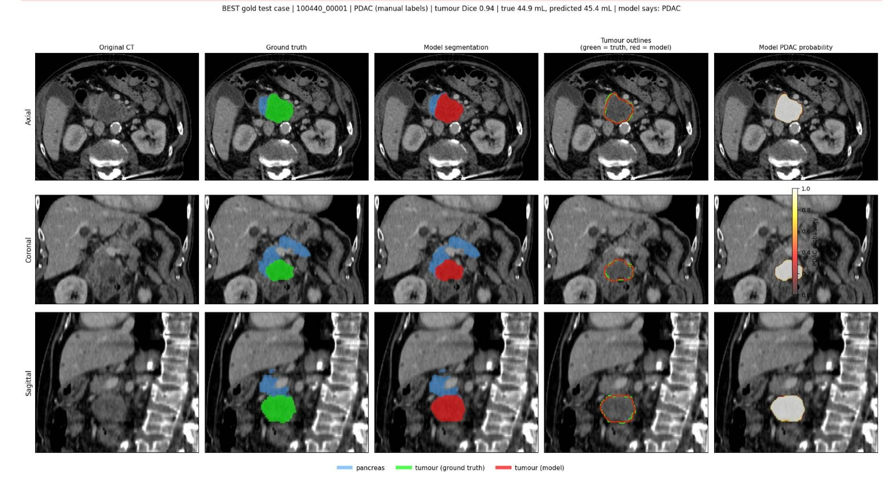
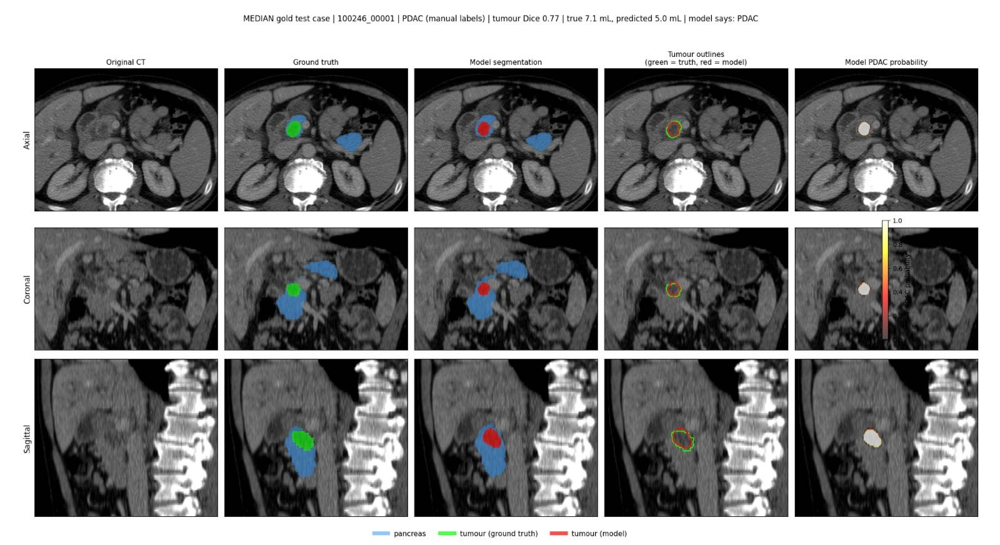
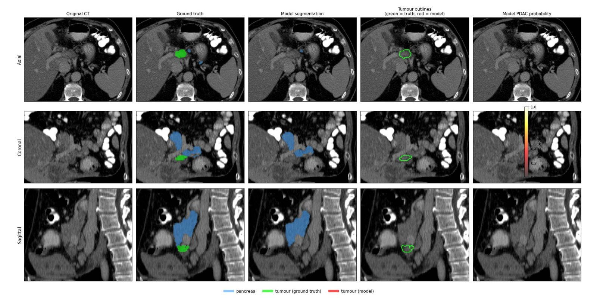
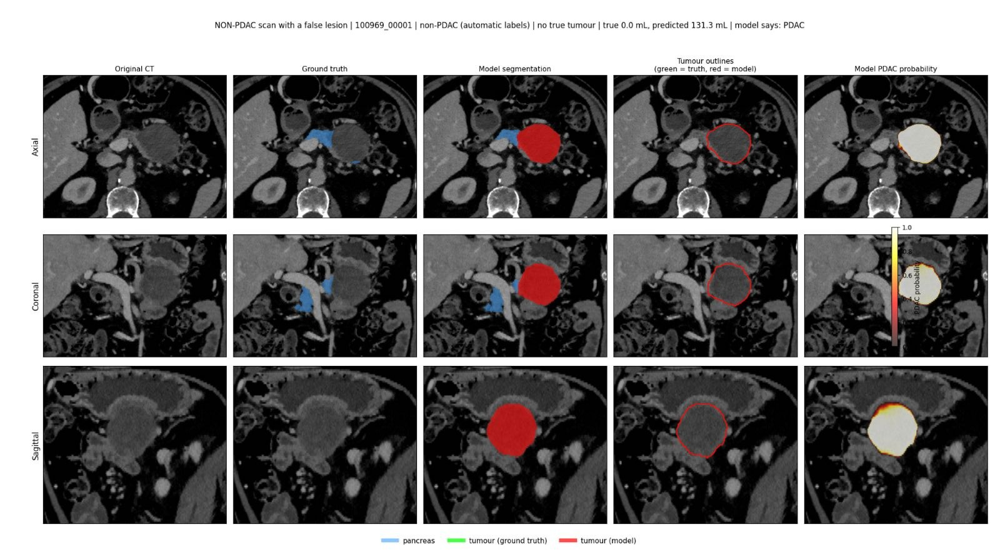
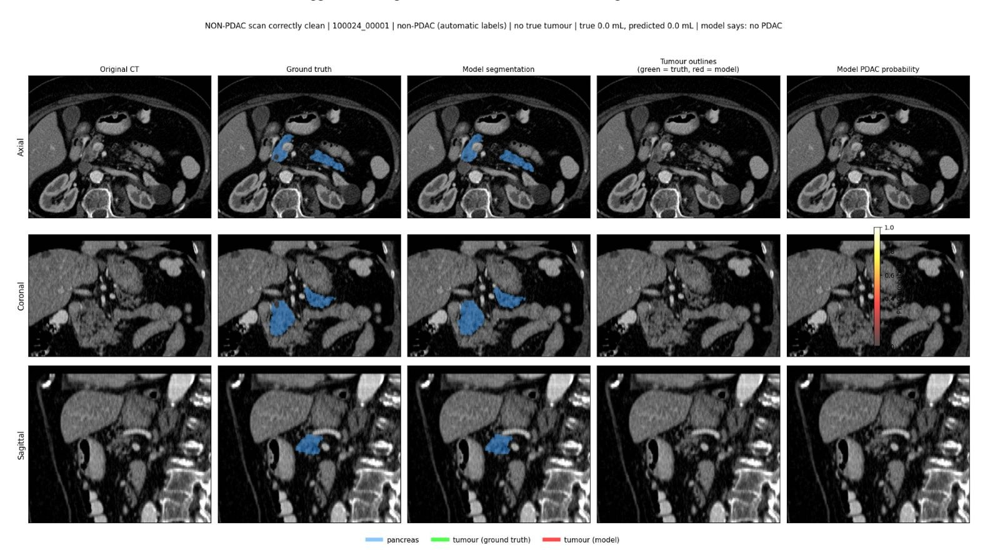

# PDAC Detection and Segmentation in CT (PANORAMA)

A two-stage 3D deep-learning pipeline that finds and segments **pancreatic ductal adenocarcinoma (PDAC)** in contrast-enhanced abdominal CT. It was trained and evaluated on the **full public PANORAMA cohort (2,238 CT studies, 194 GB)** using free Kaggle GPUs (one NVIDIA T4, 16 GB).

> **Status:** personal research project. A paper building on this work is in preparation. The code and results are shared for learning and transparency.
> **Not a medical device.** Not validated for clinical use.

<p align="center">
  
</p>

## Results (held-out test set, 338 studies)

The test set was used exactly once, after every setting had been fixed on validation data.

| Metric | n | Value | 95% CI |
|---|---:|---:|---|
| Patient-level AUROC (PDAC vs non-PDAC) | 338 | **0.952** | 0.926 – 0.975 |
| Patient sensitivity (all PDAC) | 101 | **93.1%** (94/101) | 88.1 – 98.0% |
| Patient specificity (non-PDAC) | 237 | **84.0%** (199/237) | 79.3 – 88.6% |
| Patient average precision | 338 | 0.871 | 0.805 – 0.927 |
| Tumour Dice, mean (manual masks) | 72 | **0.635** | 0.559 – 0.705 |
| Tumour Dice, median (manual masks) | 72 | **0.776** | 0.659 – 0.814 |
| Tumour detection sensitivity (manual masks) | 72 | 87.5% (63/72) | 79.2 – 94.4% |
| Tumour HD95, median (when a lesion is predicted) | 65 | 4.47 mm | 3.61 – 5.39 mm |
| Pancreas Dice, mean † | 72 | 0.925 | 0.909 – 0.937 |

Confidence intervals come from 2,000 bootstrap resamples over **patients**. † In PANORAMA the reference pancreas masks are algorithm-generated, even in manually annotated cases.

**How to read this**
- When the model finds a tumour, the outline is usually accurate: median Dice 0.776 and a median boundary error of about 4.5 mm.
- The mean Dice (0.635) is lower than the median because 9 of the 72 tumours were missed completely, and each miss counts as Dice 0. Small, subtle tumours are the main weakness.
- Validation and test results agree (validation mean Dice 0.624 vs test 0.635), so the model selection did not over-fit the validation set.

<p align="center">
  
</p>

## Example test cases

Columns: CT · ground truth · model segmentation · outlines (green = truth, red = model) · PDAC probability. Rows: axial, coronal and sagittal views.

**Best case:** tumour Dice 0.94 (true 44.9 mL, predicted 45.4 mL)


**Median case:** tumour Dice 0.77, a small 7.1 mL tumour


<details>
<summary><b>Failure modes and a correct negative</b> (click to expand)</summary>

**Missed tumour (false negative):** a small lesion the model did not detect


**False positive:** a non-PDAC scan where the model segmented a large lesion


**Correct negative:** a non-PDAC scan with no lesion predicted


</details>

## Dataset

[**PANORAMA**](https://huggingface.co/datasets/MedOtter/PANORAMA) (*Pancreatic Cancer Diagnosis: Radiologists Meet AI*), public training/development cohort from Radboud University Medical Center (Alves et al., 2024), licensed **CC BY-NC 4.0**. No data is included in this repository; the notebook streams it from Hugging Face.

| | |
|---|---|
| Studies / patients | 2,238 studies from 2,224 patients |
| Imaging | Portal-venous contrast-enhanced abdominal CT, 3D NIfTI |
| Diagnosis | 676 PDAC, 1,562 non-PDAC |
| Manual (gold) tumour masks | 482 studies |
| Automatic (silver) masks | 1,756 studies |

The 7 source labels were mapped to 3 training classes: background, pancreas (parenchyma + duct) and PDAC.

## Method

### 1. Locked patient-level split
Patients (not studies) were split 70 / 15 / 15, stratified by diagnosis and label tier. This matters because 11 patients have more than one scan. The split was stored once and reused unchanged in every session.

| Split | Patients | Studies | PDAC | non-PDAC |
|---|---:|---:|---:|---:|
| Train | 1,556 | 1,563 | 472 | 1,091 |
| Validation | 334 | 337 | 103 | 234 |
| Test | 334 | 338 | 101 | 237 |

### 2. Preprocessing
- Reorient to RAS and resample to 1 × 1 × 2 mm.
- Window to −100…400 HU.
- Crop to the body (above −500 HU, plus a 16 mm margin).

### 3. Stage 1: CT-only pancreas localizer
- A light 3D CNN (300k parameters, CoordConv input channels) regresses the pancreas centre from a coarse 4 mm whole-body CT.
- It uses the CT only, never the labels.
- Pass/fail criteria were **fixed before training**, and all of them passed:

| Criterion | Threshold | Result |
|---|---|---|
| Median centre error, manual val | ≤ 25 mm | 15.1 mm |
| Centre within 40 mm, manual val | ≥ 90% | 97.3% |
| ROI contains the whole pancreas, all val | ≥ 95% | 100% |

- A fixed 96 × 224 × 288 voxel box (192 × 224 × 288 mm) is then cropped around the predicted centre for every study.
- The crop kept the whole tumour in 100% of validation and test PDAC cases.

### 4. Stage 2: nnU-Net segmentation
- **Model:** [nnU-Net v2](https://github.com/MIC-DKFZ/nnUNet) with the Residual Encoder U-Net (ResEnc-M planner, `3d_fullres`).
  - 6 stages with 26 residual blocks.
  - Patch 64 × 128 × 192, batch 2.
- **Data:** trained on all 1,557 usable training crops (manual and automatic, PDAC and non-PDAC), so the network also sees healthy pancreas.
- **Training:**
  - Dice + cross-entropy loss with deep supervision.
  - SGD with Nesterov momentum, polynomial learning-rate decay.
  - **300 epochs (75k iterations), ~24.9 GPU-hours on a T4.**

### 5. Pre-registered evaluation
1. **Write the rules first.** The evaluation protocol was stored before any metric was computed. The notebook refuses to run if it changes afterwards.
2. **Search post-processing settings.** The search covered a grid of 70 combinations: PDAC probability threshold × minimum lesion size × keep-all or keep-largest component.
3. **Pick a setting on validation data only.** The rule: maximise mean tumour Dice on the manual validation cases, keeping the false-positive rate ≤ 15% on validation non-PDAC scans. It chose threshold 0.2, minimum lesion 100 mm³, keep all lesions.
4. **Lock it and test once.** The chosen setting was stored, then applied once to the test set.

## Engineering: 194 GB on a free GPU with 20 GB of disk

Kaggle sessions last about 12 hours and have 20 GB of disk, while the dataset is 194 GB. The pipeline is built around those limits:

- **Streaming:** the notebook downloads, preprocesses and discards cases one at a time, in shards of 50 with retries.
- **Resumability:** every phase writes a *done* marker and its results to a private Hugging Face repository. Re-running the notebook skips finished phases and continues unfinished ones, on Kaggle, Colab or a local machine.
- **Training across sessions:** checkpoints upload every 5 epochs, training stops cleanly before the session limit, and a watchdog guards against hangs. The 300 epochs ran over three GPU sessions.
- **Bugs fixed along the way:**
  - nnU-Net 2.8 trainer-constructor change (KeyError on start)
  - data-loader worker processes that kept the session alive after a clean stop

## Repository structure

```
.
├── notebooks/
│   └── pdac_panorama_two_stage_nnunet.ipynb   # full pipeline (13 cells) with outputs from the final run
├── docs/
│   ├── PDAC_Segmentation_Report.pdf           # full project report: method, results, limitations
│   └── figures/                               # figures used in this README
├── LICENSE
└── README.md
```

## How to run

1. Open the notebook on Kaggle (GPU T4), Colab or a local machine with a CUDA GPU.
2. Create a **private** Hugging Face repository for intermediate results. Set `WORK_REPO` in cell 1.
3. Add a Hugging Face **write** token as an `HF_TOKEN` environment variable or a Kaggle/Colab secret. Don't paste it into the notebook.
4. Run all cells. If a session ends, run all again; finished phases restore from the repository.

Data preparation and nnU-Net preprocessing can run in CPU sessions. Only localizer training, nnU-Net training and inference need a GPU.

**Software:** Python 3.13, PyTorch 2.11 (CUDA 12.8), nnunetv2 2.8.1, SimpleITK 2.5, scikit-learn 1.6, NumPy 2.1. **Seed:** 20261018.

## Limitations

- **Internal test set:** the test set is held out from the public PANORAMA cohort. It is not the official hidden PANORAMA test set, so results aren't comparable to the challenge leaderboard.
- **Single model:** one fold, trained for 300 epochs instead of nnU-Net's default 1,000, with no 5-fold ensemble.
- **Label quality:** 78% of training studies have algorithm-generated (silver) tumour masks. All pancreas references are algorithm-generated.
- **Evaluation resolution:** metrics are computed inside the ROI crop at 1 × 1 × 2 mm, not at native scan resolution.
- **Missed tumours:** small and subtle tumours are the main failure mode.

## Next steps

- Train for the full 1,000 epochs and ensemble 5 cross-validation folds.
- Add a patient-level classifier on top of the segmentation (lesion volume, peak probability, duct dilation) to raise specificity.
- Use the vessel and pancreatic-duct labels as extra training classes.
- Evaluate at native resolution.

## References

1. Alves N. et al. *PANORAMA: Pancreatic Cancer Diagnosis – Radiologists Meet AI.* Zenodo, 2024. doi:10.5281/zenodo.10599559
2. Isensee F. et al. *nnU-Net: a self-configuring method for deep learning-based biomedical image segmentation.* Nature Methods 18, 203–211 (2021).
3. Isensee F. et al. *nnU-Net Revisited: A Call for Rigorous Validation in 3D Medical Image Segmentation.* MICCAI 2024.
4. Alves N. et al. *Fully automatic deep learning framework for pancreatic ductal adenocarcinoma detection on computed tomography.* Cancers 14(2), 376 (2022).
5. Liu R. et al. *An intriguing failing of convolutional neural networks and the CoordConv solution.* NeurIPS 2018.

## Acknowledgements

PANORAMA data courtesy of the PANORAMA challenge organisers (Radboud University Medical Center), used under CC BY-NC 4.0. The CT images in `docs/figures` are derived from this dataset and carry the same licence. All experiments were run by the author, and every reported number comes directly from the run outputs.

## License

Code: [MIT](LICENSE). Dataset and derived images: CC BY-NC 4.0 (see above).

**Author:** Divyanshu Sharma · [GitHub](https://github.com/DivyanshuSharmaCoader)
